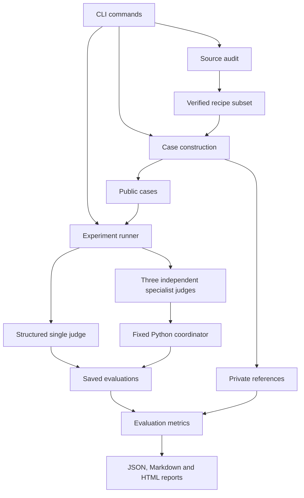

# MACRO team code guide

The `macro` package is divided by responsibility. The command entry point is `cli.py`;
both `macro ...` and `python -m macro ...` call it. Runtime settings remain in
`configs/pilot.json`. Changing the folder layout does not change the experiment policy,
model settings, case contents, or output formats.

## Where to work

| Responsibility | Folder / key file | What belongs here |
|---|---|---|
| Dataset preparation | `src/macro/evaluate_case_generation/source_audit.py` | Parse source ingredients, filter records, audit HUMMUS, sample the subset |
| Evaluation cases | `src/macro/evaluate_case_generation/cases.py` | Construct profiles and pairs, write factual explanations, preview and validate cases |
| Judge instructions | `src/macro/ai_agents/prompts.py` | Shared criteria, role instructions, public case input and A/B mapping |
| Judge output format | `src/macro/ai_agents/schemas.py` | Required fields, structured-output schema, evidence-pointer validation |
| Agent execution | `src/macro/ai_agents/agents.py` | Fresh AG2 agents, model requests, response handling and bounded tool rounds |
| Agent tools | `src/macro/ai_agents/tools.py` | The arithmetic tool shared by all four roles |
| Coordinator | `src/macro/coordinator/aggregation.py` | Validate specialist findings, derive comparisons, apply fixed aggregation and retain diagnostics |
| Experiment execution | `src/macro/evaluation/runner.py` | Original/reversed runs, call budgets, request ledger, saved assessments and resume checks |
| Evaluation metrics | `src/macro/evaluation/metrics.py` | Compare outputs with private references; calculate accuracy, consistency and order stability |
| Reports | `src/macro/reporting/` | Build JSON/Markdown summaries and readable HTML from saved results |
| Shared policy | `src/macro/shared/policy.py` | Ingredient vocabulary, objective definitions, deterministic reference functions and candidate swapping |
| File handling | `src/macro/shared/io.py` | JSON/JSONL persistence and hashes |

Package `__init__.py` files identify Python packages and initialize no agents. The case
generation package also declares its generator version. The same AG2 factory configures
all four judge roles; their distinct instructions and schemas are in `prompts.py` and
`schemas.py`, rather than four duplicated API implementations.

## Reading the execution flow

1. Start at `cli.py` to see which command calls which component.
2. Follow `evaluation/runner.py` for the experiment loop and where outputs are saved.
3. Read `ai_agents/prompts.py`, then `schemas.py`, then `agents.py` to understand the judges.
4. Read `coordinator/aggregation.py` for the specialist panel's final decision.
5. Read `evaluation/metrics.py` and `reporting/summary.py` for evaluation and reporting.

The runner loads private references for experiment identity and scoring, but only the
public case enters agent messages. The coordinator receives specialist assessments only.
`shared/policy.py` contains both reusable decision rules and reference calculations;
the coordinator uses the rules and reported scores, never the case-reference calculator.
The private evaluation reference appears separately in the final HTML report for reviewers.

## Boundaries to preserve

- Keep RQ1/RQ2 scope: structured single judge versus three independent specialists with
  fixed aggregation. Explanation variants and selective discussion are future extensions.
- Model/API calls belong in `ai_agents/agents.py`. `plan`, saved-result reporting, case
  construction and the coordinator do not need a paid API request.
- Model responses and historical results remain auditable. Refactors must not silently
  regenerate old verdicts or overwrite experiment artifacts.
- Shared criteria should remain identical across both systems. `shared/policy.py` owns
  numeric tolerances and ordering rules so components do not acquire conflicting copies.
- Resume identity fingerprints every nested Python module with its package-relative path.
  Changes to code, prompts, schemas, inputs or configuration require a new run ID.
- Internal development fixtures stay in `tests/`; the user-facing `run` command always
  uses real judges and requires explicit paid-API acknowledgement.

## Existing data and supporting files

`data/subset/` and `data/pilot/` contain the generated benchmark artifacts. `results/`
contains saved real experiments and remains ignored by Git. `scripts/verify_pilot_sources.py`
is the separate source-record verification utility. Documentation and project PDFs live in
`docs/`; the phase checklist is in `PLAN.md`.

The package is discovered automatically by setuptools under `src/`. A teammate can use
the existing README setup commands to install all subpackages and the `macro` entry point.
